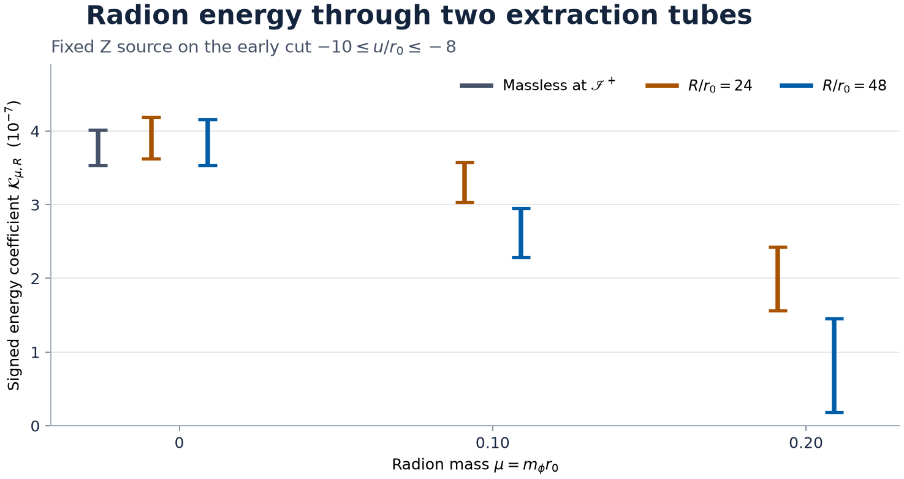

# GLR-GOAL-016 · Radion radiation and stabilization

**Outcome B, with constructive preparation and transport results.** The fixed-source mass comparison is certified at both finite tubes, and the vacuum quadratic signal has a quantitative preparation-stability theorem. The full finite-amplitude vacuum trace and a matched stabilized GL spectrum remain open.

- **Vacuum preparation.** For the original exactly constrained and ADM-mass-tuned family, the infimum homogeneous preparation energy required to cancel the entire quadratic radion news on \(u/r_0\in[-10,-8]\) lies between \(1\) and \(1.20\) times the Z window energy, in the same order-four energy units. The lower bound holds for arbitrary compact incoming and outgoing scalar data. The upper bound uses a smooth causal inverse and a regular static continuation. All such changes keep the first GL jet and circumference fixed. If the added homogeneous energy is at most one quarter of the lower bound for the Z coefficient, at least one quarter of that lower bound survives in the quadratic signal. [Preparation theorem](PREPARATION.md)
- **Finite-radius transport.** With the same source and zero Z scalar Cauchy jet, the signed early energy strictly decreases across \(m_\phi r_0=0,0.10,0.20\) at both \(24r_0\) and \(48r_0\). Each positive mass also carries less signed energy through \(48r_0\) than through \(24r_0\) on these fixed retarded cuts. The physical current, including the finite-cut surface term, is used in every comparison. [Certificate and reproducible enclosures](transport/CERTIFICATE.md)
- **Small mass and distant extraction.** At fixed positive mass the actual Z signal has zero early null-limit flux. As \(\mu\to0\), \(R\to\infty\) with \(\mu^2x(R)\to\Lambda\), the waveform is \(e^{-(\Lambda/2)J}n_Z\), where \(J\) integrates over the preceding retarded times. Its signed limiting energy is strictly suppressed for \(0<\Lambda\le2\Omega r_0\). The two orders of the small-mass and large-radius limits give zero and the nonzero Z coefficient, respectively. [Riemann-kernel proof](transport/CRITICAL-LIMIT.md) · [Independent weighted evolution and sign proof](verification/REVIEW.md)
- **Action-level obstruction.** The specified Unruh Dirac state has positive outward power, which obstructs stationary spherical reflection-symmetric matching without compensating inward power. The flat radion mass leaves a local Gauss–Bonnet coefficient free. On a differentiable stationary branch at the vacuum base, varying that coupling changes the static threshold with a strictly positive fixed-ADM derivative. The curved renormalized state, response and constraint matching are still required for a physical stabilized prediction. [Stabilizer study](stabilization/MATCH.md)

## Waveform and energy comparison

The pinned GOAL-005 mode has \(L/r_0=10\), \(\Omega r_0\in[0.06328118,0.06328120]\), and \(H_{\theta\theta}/(2r^2)=1\) at \(r/r_0=2\) for the real unhalved cosine. The calculations use the slightly wider independently replayed GOAL-005 bracket \((0.06328117,0.06328121)\). On the regular slice \(\tau=v-r=0\), Z prescribes vanishing completed radion value and normal derivative at order two. Original Z and damped Z give the same quadratic trace, with different higher constrained data and differentiated end classes. On the massless null window the exact quadratic coefficient is
\[
 3.5316\times10^{-7}<\mathcal K_Z=2\|n_Z\|_2^2<4.0171\times10^{-7},
 \qquad 6.5671\times10^{-5}<n_Z(u)<6.7662\times10^{-4}.
\]
The replay reproduced the original enclosure byte for byte. The maximum bound on the curvature correction to the direct free-source news is \(7.692\times10^{-6}\), and the outer direct-source tail contributes less than \(1.223\times10^{-18}\). Thus the exact free-source approximation has a curvature waveform error below \(1.088\times10^{-5}\) in \(L^2\) on this window, in addition to the enclosed source integration errors when using finite cells. [Inherited waveform and interval](../GLR-GOAL-005/RADIATION.md) · [Replay](checks/inherited_interval_replay.txt)

For the massive comparison, \(\mathcal K_{\mu,R}=E_R/(\epsilon^4M_0)\) is the normalized energy coefficient in the fixed-background scalar experiment, using the complete vacuum quadratic source as prescribed work. The entries are outward enclosures in units of \(10^{-7}\).

| \(R/r_0\) | \(\mu=0\) | \(\mu=0.10\) | \(\mu=0.20\) |
| --- | ---: | ---: | ---: |
| 24 | [3.6251168, 4.1905127] | [3.0342635, 3.5761848] | [1.5602610, 2.4262095] |
| 48 | [3.5327523, 4.1610766] | [2.2879857, 2.9482768] | [0.1815300, 1.4523583] |

These intervals include source normalization and propagation, graph intersections, the analytic source tail, whole-cell kernel quadrature, the full Schwarzschild potential correction for the field and both null derivatives, and the signed flux integration. The proof uses the exact constant-mass Bessel kernel and bounds the residual against the Schwarzschild propagator. The verifier independently reconstructed the energy current and audited the first tube's continuum error proof and sign-changing kernel. The coarser bounds that failed separation are retained. [Tube error budget](transport/CERTIFICATE.md) · [Independent audit](verification/REVIEW.md)

The certified early decrease is an observable difference on the chosen cuts. Arrival delay, changed source work, storage and later absorption can all affect this comparison. The joint-limit theorem gives the full leading early waveform in the regime \(m_\phi^2 r_0x_{\rm phys}\to\Lambda\). In particular for \(0<\Lambda\le2\Omega r_0\) the limiting coefficient decreases by more than \(5.17\times10^{-9}\Lambda\) relative to the massless value. An external detector's tidal response additionally requires a specified coupling. [Frame, current and detector model](transport/OBSERVABLES.md)

For one stipulated \(\mu=0.20\) completed source, the dimensionless band \([4,4.25]\) in \(\omega r_0\) has each of the escape and horizon energy coefficients bounded above by \(7.89064\times10^{-6}\). Adding a smooth localized later pulse leaves the entire early wedge unchanged and yields \([0.0335298,0.0451132]\) for each channel on the same band. The band is a completion control. The source work, threshold and high-frequency bounds leave the uncomputed middle band and total escape fraction unresolved. The measured GL growth exponent and the complete early waveform alone cannot fix a timelike escape spectrum. [Completed-band certificate](transport/CERTIFICATE.md) · [Analytic completion control](verification/REVIEW.md#4-above-threshold-escape-and-completion-control)

## Vacuum finite-amplitude gate

The GOAL-009 terminal transform leaves a term proportional to \(\alpha R^{-1}K(-D)\partial_z^2 Z\) when the mean radion radiates. An explicit high-compact-harmonic pairing costs \(|\alpha||k_m|/R_*\) in the inherited same-order forcing estimate. A bounded rational transform removes this leading nonlocal term about a circle-independent radiating mean. It preserves the mixed derivative at the stated order and includes the shift and potential variation. A direct warped-curvature calculation reproduces the symbol and rejects omission of the potential variation. The higher, nonmean principal couplings still require a finite-derivative positive current or an equivalent normal form. The radial constraints and clock must be matched to the actual Cauchy and terminal sections. The corrected five-dimensional area normalization uses \(V_5/B_\infty\to1+2N_\epsilon/\sqrt3\), with the inertial clock and trace compared in the four-dimensional Einstein area. [Derivation and stopping condition](vacuum/TRACE.md)

If the remaining theorem gives \(\|N_\epsilon-\epsilon^2 n_Z\|_{L^2(I)}\le C_I\epsilon^4\) on a common physical window, the exact energy is between \(2\epsilon^4(\sqrt{\mathcal K_-/2}-C_I\epsilon^2)_+^2\) and \(2\epsilon^4(\sqrt{\mathcal K_+/2}+C_I\epsilon^2)^2\). Strict positivity is sufficient when \(C_I\epsilon^2<4.20214\times10^{-4}\) within that exterior domain. The new optical calculation gives neither \(C_I\) nor a certified numerical seed interval. [Full waveform and energy error budget](PREPARATION.md#relation-to-finite-amplitude-radiation)

## Acceptance matrix

| Claim | Status | Scope |
| --- | --- | --- |
| Exact ADM-tuned constrained Z family and strictly positive early quadratic news | Inherited and replayed | GOAL-005 scalar coefficient and source normalization. Original and damped higher jets are distinct. |
| Energy cost of exact cancellation and stability under small homogeneous preparations | Proved and separately audited | Smooth compact original GOAL-005 free scalar data, at quadratic order. |
| Full common-clock vacuum \(O(\epsilon^4)\) news remainder | Open | Leading compact-symbol obstruction and repair proved on the stated terminal linearization. Complete commuted estimate and matching absent. |
| Three masses separated at two finite tubes | Directed and adversarially audited | Prescribed Z source on Schwarzschild, finite signed physical energy. |
| Fixed-positive-mass null decay and joint \(\mu^2 x\) limit | Proved | Actual early Z response on fixed Schwarzschild. Two derivations of the joint limit. |
| Above-threshold completed-history band | Directed for the stipulated completions | Separation in each channel. No total timelike allocation. |
| Stationary candidate and curvature dependence | Obstruction and conditional directional derivative | Unruh flux test for the chosen state and positive Gauss–Bonnet direction at the differentiable static vacuum base. The matched semiclassical GL shift and emitted amplitude are open. |

The next vacuum obstacle is a truncation-uniform estimate of the incoming derivative against the exact coupled compact principal operator after the leading correction. Its Cauchy and terminal boundary terms must realize the mass-tuned damped preparation in a common inertial clock. For a stabilized observable the separate next input is the renormalized curved stress and its constraint-compatible retarded \(n=1\) and quadratic mean responses. [Limitations and failure ledger](LIMITATIONS.md) · [Reproduction](REPRODUCIBILITY.md) · [Milestones](LEDGER.md) · [Handoff](HANDOFF.md)
