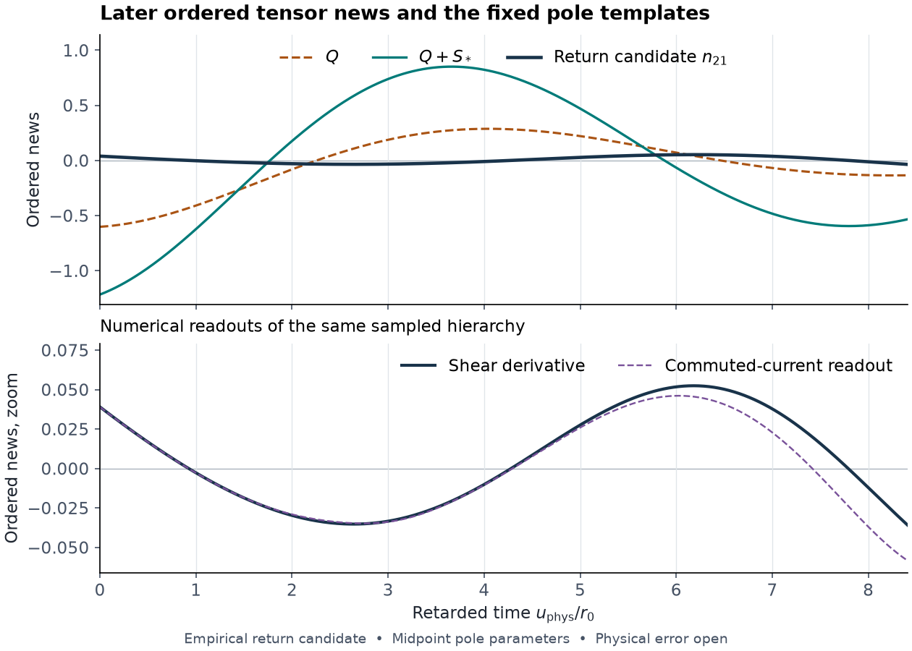

# GLR-GOAL-017 — Physical finite-time ringdown

**Meaningful partial outcome for the fixed ordered experiment.** On
\(I=[0,8.407362]\), the unperturbed axial news has a directed absolute
\(L^2\) error below \(3.898\times10^{-5}\) and its own ordinary
fundamental fails the half-tolerance test. The complete returning
candidate gives midpoint mismatch ratios \(1.01834\) for \(Q\) and
\(1.01949\) for \(Q+S_*\), compared with the target \(1/2\). Both
physical return tests remain unresolved. A directed absolute error
\(E_{21}\le0.31731\) for this candidate would suffice to reject both.
[Charter](GOAL.md) · [Pinned inputs](PROGRAM.md) · [Candidate records](checks)
· [Verification](verification/REVIEW.md).

## Physical waveform and comparison

The observable is the real axial \(\ell=2\) zero-mode tensor news at
null infinity in the inertial Einstein frame. For the fixed real
packet on \(v=r\), \(L/r_0=10\), \(R/r_0=13/8\), and \(\delta=3/25\),
the ordered news is \(N_T=\eta N_{01}+\epsilon^2\eta N_{21}\).
Both signals use the same canonical seed, ADM mass, compact
circumference and physical cuts. The returning hierarchy includes both
mixed polarizations, the direct quadratic term, the fixed-mass mean
and the constraint-induced graph jets. The translated pole is a
frequency-space feature of the GL-driven ordered response. Its
oscillation frequency equals the ordinary pole's and its decay
exponent is shifted by \(2\Omega r_0\). The stationary Schwarzschild
operator remains the Regge–Wheeler operator. [Ordered source ledger](../GLR-GOAL-013/SOURCE-LEDGER.md)
· [Frame and flux](../GLR-GOAL-014/FLUX-AND-FRAME.md)
· [Translated residue](../GLR-GOAL-012/REPORT.md).

The leading scalar master calculation compactifies the entire later
characteristic wedge and verifies the graph-conforming reconstruction
with a whole-cell energy residual. It encloses
\[
 \|N_{01}\|_2\in[0.00501844,0.00509641].
\]
The leading ordinary news pair \(P_{01}\), with its own physical
residue, satisfies
\[
 \|P_{01}\|_2\in[0.00167156,0.00171293],\qquad
 \frac{\|N_{01}-P_{01}\|_2}{\|P_{01}\|_2}\in[2.02612,2.16772].
\]
Thus a single ordinary pole at the fixed amplitude is insufficient
even for the matched baseline on this window. This verdict concerns
the entire baseline and its own physical residue. [Baseline certificate](spectral/COMPARISON.md).

The returning calculation uses a graph-aligned local characteristic
march and a weak scalar primitive. With the clustered cap candidate
continued to infinity, \(\|n_{21}\|_2=0.0874137890\ldots\).
The directed norms of the two midpoint mismatches are about \(0.7490\)
and \(1.7893\). The boxwise rejection thresholds include the inherited
residue and exponent uncertainties, and are conditional on the physical
waveform error. The approximate remainder after subtracting both pairs
is large compared with the empirical total return. A directed bound
for the aggregate remainder follows from
\(\|N_{21}-(Q+S_*)\|_2\ge\|n_{21}-(Q+S_*)_{\rm mid}\|_2-E_{21}-\Delta_{Q+S_*}\).
The individual prompt, overtone, branch-cut and other contributions
were not separately enclosed. The inverse-contour wings and projected
cut jumps remain additional inputs to such a decomposition.
[Candidate arithmetic](checks/candidate_gates.py)
· [Inverse and contour budget](spectral/COMPARISON.md).

The matched relative ordered change is exactly
\(\epsilon^2\|N_{21}\|_2/\|N_{01}\|_2\). Inserting the candidate into the
numerator gives approximately \([17.1520,17.4186]\epsilon^2\) with the
directed baseline denominator. For a physical interval the numerator
endpoints must be replaced by
\((0.08741378900667-E_{21})_+\) and \(0.08741378900668+E_{21}\).
Positive separation in this fixed family requires a nonzero physical
correction bound. A finite-seed conclusion further needs a uniform
nonlinear news remainder in the same cuts and frame and small
\(|\epsilon|e^{\Omega t}\) throughout the significant source region.
Neither a finite-seed interval nor a physically identifiable slower
component is established. [Matched comparison and nonlinear remainder](spectral/COMPARISON.md).

## New estimates and failure mechanisms

- Subtracting the exact free current lift gives a positive-energy
  strong estimator for the scattered remainder. Only the outgoing
  derivative of one integrated current error needs strong control on
  the later interval. Pre-window errors enter through undifferentiated
  current norms and the earlier cap shear. At \(r_c=400r_0\) the late
  exterior gain is below \(1.000135\) and the separately bounded
  physical source tail enters at order \(10^{-6}\). A smooth
  short-scale example shows why weak current norms alone cannot
  provide strong later news. [Strong estimator](analysis/STRONG-NEWS.md).
- The empirical commuted-current readout integrates an incoming
  derivative with \(\|\int|\partial_tF_h|\,dv\|_2\) about \(6763\).
  Its disagreement with the shear derivative fell from \(0.10259\)
  to \(0.02841\) on the cap with incoming-ray refinement. The
  continued shear candidate changed by about \(0.00043\) between those
  meshes. Whole-cell checks on selected interior cells find the
  shifted mixed residual largest near the narrow launch. The
  same-array comparisons share the lower solution and give no
  continuum error. [Numerical records](checks).
- Backward positive energy yields a weak rejection estimator with
  no exponential-in-window constant and no differentiation of the
  return currents. A second transposition uses the exact mixed
  graph contact to express a tapered moment using the uncommuted
  baseline first jet and a backward mixed solve. The signed
  thresholds and numerical moment allowances are evaluated.
  Physical adjoint and current quadrature errors remain open.
  [Weak witnesses](analysis/WEAK-WITNESSES.md).
- A derivative-free positive-line inverse subtracts the exact free
  and first-scattering time kernels. The remaining high-band error
  decays as \(B^{-3/2}\) for the stated weighted source and Cauchy
  norm. The estimate keeps the graph contact. The physical
  low-band cells and weighted source norms remain unevaluated.
  [Positive-line calculation](spectral/COMPARISON.md).
- The normalized GL and fixed-infinity mean interface extends to
  \(r/r_0=1+1/112<b(d)\). The regular EF series resolves the
  near-horizon singular algebra in the metric reconstruction.
  Some second-jet whole-cell boxes remain broad, and converting
  the boxes into candidate coefficient errors is a distinct
  step. The GOAL-015 short-window certificates are read-only
  inputs with their original domains. [Coefficient extension](analysis/GEOMETRY.md).

## Finite-time identifiability obstruction

Two constructions show that, in the enlarged retarded scalar
Regge–Wheeler class with variable sources, the original graph data,
early waveform and both pole residues can be preserved while changing
the later news densely in \(L^2(I)\). One uses compact spacetime forcing
and a real polynomial in \(\partial_t\) that annihilates the designated
Laurent residues. The other prescribes compact outgoing shear in an
exterior Volterra problem and cuts it off smoothly in a radial annulus.
It has an entire news transform. The compact spacetime control gives
opposite template verdicts at the same residues, as well as arbitrarily
small changes after fitting a baseline amplitude. The fixed Einstein
hierarchy fixes the source and excludes this freedom.

The isolated translated pair does have a directed distance
\([0.30064053,0.34380362]\) from the full ordinary-frequency real
amplitude and phase span on \(I\). The two midpoint acceptance balls
overlap, so even passing both full-window comparisons would leave
the decomposition ambiguous. A physical GL signature requires an
evaluated complete return or a directed observable that separates it
from a specified matched family. [Independent verification](verification/REVIEW.md)
· [Second construction](spectral/COMPARISON.md).

## Acceptance matrix

| Claim | Status and missing input |
| --- | --- |
| Ordered leading later news and ordinary-pole mismatch | Directed for the pinned preparation. Graph-conforming scalar residual and baseline amplitude box evaluated. |
| Ordinary and translated physical pole residues | Inherited from the pinned source stack and separate audits. Template factors, boxes and projection geometry independently checked here. |
| Complete ordered later candidate | Both mixed polarizations, direct and mean sources and induced graph included. Empirical waveform plus directed arithmetic on its exact affine reconstruction. |
| Absolute physical return error and the two fixed-template tests | Open. Need a directed compact energy and trace certificate. The sufficient \(E_{21}\) ceilings for the clustered candidate are \(0.31731\) and \(0.80484\). |
| Separate physical prompt, other poles and cuts | Open. Bounds for total inverse and subtracted remainder are available as formulas. The weighted physical source and contour data are missing. |
| Matched total tensor signal | Conditional on \(E_{21}\). The denominator and its ordinary-pole mismatch are certified. Absolute and relative change formulas include the leading signal. |
| Identifiable translated component at finite seed | Open. Uniform nonlinear remainder and a separation margin for a common frame and preparation are needed. |
| Residue-based finite-window inference with variable scalar forcing | Obstructed by two explicit retarded constructions. |
| Independent Work review of this goal | Future audit. Internal original derivations, independent reconstructions and shared-sample checks are separately recorded. |

The main full-strip certificate stopped after the recorded bounded
refinements. The immediate re-entry point is to evaluate the whole-cell
uncommuted lower residual and coefficient errors and the differentiated
\(F\) ray error on \(I\), with matched graph, seam and cap data. The
alternative weak route needs a directed signed moment error below the
recorded allocations. It can reject without certifying the complete
\(L^2\) waveform. [Reproduction](REPRODUCTION.md) · [Handoff](HANDOFF.md)
· [Ledger](LEDGER.md).
