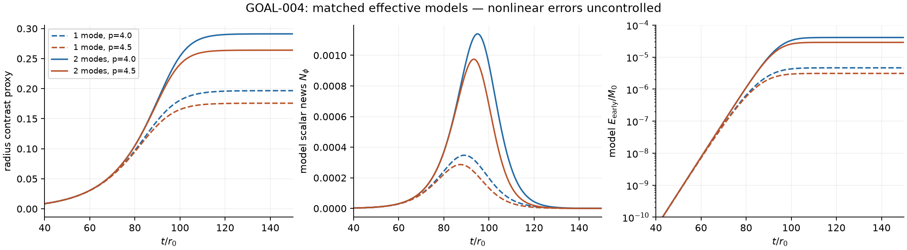

# GLR-GOAL-004 final scientific report

Task **T-20261023-GLR-GOAL-004**, executed 2026-10-23. Executor:
**Savdeep Sethi**, authorized sole writer/publisher on
`inaeyk/GL-with-AI:research/sav-radiation`. Only `research/sav/**` changed.
**Terminal classification: MEANINGFUL_PARTIAL.** Goals 001--003 retain
their completed MEANINGFUL_PARTIAL classifications.

| Required question | Verdict | Precise reason |
|---|---|---|
| Nonzero numerical/invariant A_star for an exact global fixed-charge GL family? | **NO** | Physical C5 input/source enclosure, simultaneous global constraint map and nonlinear estimates remain unclosed |
| Physical finite-time massless-radion news and two-sided energy enclosure? | **NO** | No bounded exact-family radiation trace or fourth-order news remainder; only conditional inequalities |
| Certified window reaches an invariant actual first bulge, with physical energy/fraction? | **NO** | No nonlinear MOTS/data-to-Bondi bridge; large-bulge model truncations fail residual tests |
| Separate reproducible semi-analytic predictions? | **CONDITIONAL / YES as calibrated models** | Two constitutive actions, one- and two-mode dynamics, matched scalar kernels and explicit numerical predictions; physical errors uncontrolled |

The exact finite-A closure failed within its bounded strategies. The
independent model program was nevertheless carried through to computed
waveforms, spectra and energy histories, including a substantive second
mode repair and its failure to produce a converged approximation. No
model number below is a controlled physical first-bulge percentage.

## 1. Provenance, inspected evidence and boundaries

Initial local checkout was clean at
`97a52c42c39018ac9b41f70b0ba9b08cd67c05bc`. Fresh fetch found three
Sav-authored preparation commits, ending at the actual execution input
**`2f4648c379c474ed124e3ef10b62efcd4a783c66`**. Their entire diff was
research/sav-only; the clean branch was advanced with the runbook's
`git pull --ff-only origin research/sav-radiation`. No merge commit or
history rewrite occurred. The authenticated GitHub login was `savsethi`,
id 45701520, matching the recorded author identity; this is identity/
history inspection, not a claim of independently verified signatures.
The user's executor and sole-publication authorization governed this run.

The complete GOAL-004, review gates and Sav/Michael runbook were read,
with AGENTS/HANDOFF/STATUS/NOTATION/SOURCES/DECISIONS/QUESTIONS. The prior
three final reports, forced-master/inverse, exact local constraints,
ordered higher sources, quadratic radion, retarded transfer, finite-data,
radiation/EFT derivations and all relevant old adversarial audits were
inspected across the primary investigator and the bounded specialists.
The attributed [GOAL003 review qualifications](../verification/GOAL003_REVIEW_QUALIFICATIONS.md)
remain binding. In particular the old advertised W-versus-R contrast is
not counted as an independent proof, and the old inverse author's audit
does not constitute external independent review of every estimate.

No production code was imported or changed. No GRChombo, CCZ4, MPI/AMR,
cluster, full 2+1/5D evolution, physical campaign, manuscript, Overleaf,
collaborator message, other-branch write, merge, force push or next Goal.
The four small effective ODEs are model quadratures, not Einstein
spacetime simulations. Historical D16 and M2-C negatives are unchanged.

## 2. Physical source evaluation: progress and its first failed estimate

Read [the full source/geometry derivation](../physics/goal004_source_geometry.md).
The actual empirical L10 normalized positive-k input was used in all
seven quadratic SO(3) source components, including both real-cosine
weights, sourced n=2 trace/divergence, regular EF cancellations and all
three local Einstein-source Bianchi identities. This improves the old
local analytic-continuation controls; it is not a new physical eigenmode
enclosure. Local on-shell jet residuals and global interpolation error
are explicitly separated.

| L10 quantity, r0=1 | Computed value | Evidence / missing error |
|---|---:|---|
| Reused Omega | .06328118897590773 | Historical empirical eigenpair, no interval enclosure |
| Reused C0 | 12.3072919724 | Historical empirical quadratic transfer |
| Horizon master coefficient a_h | -38.4974128714 | Regular Frobenius/profile connection, empirical |
| Linear AH contrast / A | 6.90024548826 | Exact linear formula evaluated on empirical a_h; no nonlinear remainder |
| Full +2 source ||mathfrak F||2 on sampled interval | 16.64667045 | Grid quadrature, not a whole-line upper bound |
| Truncated +2 response ||u||2, finest | 113.147934 | Three n=2 configurations; horizon omission retained |
| Generic ||F||/s² comparison | 1039.2453 | Conditional operator estimate fed sampled input, not a certified bound |
| Sampled complex +2 regular tetrad maximum | 92.66696 | Only 1.005<=r<=10; real cosine has factor two; **not M2** |
| Fixed-quadratic-charge zero-metric beta_hat, mu_hat near horizon | 78.83490305, 7.40924114 | Strip exp(s v_EF); incomplete tails/derivatives, no scalar conformal part |
| Frozen spatial-source static scalar transfer T(0) | 13.27718117 / 13.27718166 | Two shared-profile quadratures; agreement is not certification |

Local source Ricci/Bianchi checks reach residuals below ~2e-30, but
they assign local jets on shell. Actual sampled interpolation defects
are ~4.63e-6 in the Riccati equation and ~4.72e-7 in its log amplitude.
Tiny local algebra residuals do not bound the global physical input.
The code does not evaluate all seven inhomogeneous equations on the
sampled reconstructed q2; its interpolation, forced-tail and regular
metric residuals remain unenclosed. This mandatory physical-response
check is incomplete and prevents Gate A acceptance.

New exact endpoint results include conservative horizon/Coulomb Volterra
inequalities and the monotone nodeless matching identity

\[
F'(\Omega)=2\Omega\left[\int_{-\infty}^{x_m}
(u_H/u_H(x_m))^2dx+\int_{x_m}^\infty(u_I/u_I(x_m))^2dx\right]>0.
\tag{1}
\]

The empirical derivative is ~4.529895. Validated endpoint/flow error
epsilon_F and a lower derivative dF would give a root error <=epsilon_F/dF;
neither is replaced by a floating matching residual. Reviewer I separately
derived a maximum-principle bound |u|<=Cw w, with
w=e^-r/2 r/(1+K²r³), Cw=sup |F|/[w(s²+Hw/w)]. It requires an
enclosed source supremum and exact endpoint class; samples are insufficient.

The first missing quantitative source inequality is now explicit:

\[
\|H-H_{app}\|_{C^5_{reg,weighted}}\le\varepsilon_5,
\quad
\|Q[H]-Q[H_{app}]\|_{Y_0}
\le C_B(2B_5\varepsilon_5+\varepsilon_5^2)+C_\Omega|\delta\Omega|.
\tag{2}
\]

Y0 reserves three source derivatives; the Ricci source contains two
field derivatives. Thus even a C0 metric estimate needs a uniform C5
input error, not just sampled source values/first derivatives. Endpoint
normalization, intermediate propagation, divided-difference derivatives
and homogeneous data are still missing. There is no physical numerical
M2 to insert into an A_star inequality. Two source strategies and all
three allowed n=2 configurations were used; no extra k or root solve.

## 3. New constraint mathematics, without a global GL theorem

[The data/news note](../physics/goal004_data_news.md) fixes an all-orders
local free-data prescription, with growing GL tangent, zero independent
additional harmonics and two scalar preparations F=0 or a specified
compact bump. Both are exact simultaneous **local collar** families
under the prior local theorem. Neither has a proved global charge-fixed
completion. Perturbative P/Z choices and the exact scalar-only family
retain their different scopes.

A new exact spherical subfamily calculates background mass transversality.
At epsilon=0 hold the improved radial momentum data at their background
values and set a(Ri)=a0(Ri) exp(lambda). Then

\[
a^{-2}={r\over r+1}+{C(\lambda)\over r},\quad
C={R_i^2\over R_i+1}(e^{-2\lambda}-1),\quad
M(0,\lambda)=M_0(1-C),
\]
\[
\boxed{\partial_\lambda M(0,0)/M_0=9/14\quad(R_i=3/4).}
\tag{3}
\]

It has positive radial lapse inverse on the whole r>=Ri exterior. This
closes the *background derivative*, formerly listed as wholly uncomputed.
It does not establish global existence/C1 dependence of the simultaneous
z-dependent family. The inner boundary is varied, in accord with the KID
pairing; it is not deleted. Fixed ADM tension/asymptotic stress likewise
requires a compatible global spacetime prescription, not an arbitrary
extra regular scalar hair.

The independently derived H1 momentum estimate makes the differentiated
gap explicit: integrability of ||a_z||infty and ||a_zz||infty is needed
beyond the conserved zeroth-order weighted momentum energy. A new exact
linear lapse kernel shows how parabolic damping can give angular
alpha_n=O(r^-4) from bounded momentum modes while the zero mode carries
the 1/r mass tail. The complete nonlinear Fourier/Sobolev estimate,
maximal regularity, positive lapse and ADM limit are still unproved.
This is a concrete route, not a no-go or a relabeled finite-collar result.

## 4. Nonlinear propagation, quartic news and the strongest inequality

The exact SO(3) action can be put in 2+1 Einstein-scalar form using
g3E=(R/r0)^4g3, chi=sqrt(12) log(R/r0), U3=-2r0^-2 exp(-sqrt(3)chi).
Its generalized-harmonic principal system is hyperbolic in regular
compact regions. The frame grows at infinity; chi is the orbit dilaton,
not the n=0 KK radion. No nonlinear global redshift/exterior/radiation
trace estimate follows just from that local form.

The full ordered Q3,Q4 and scalar/Bondi completion remain as in the
prior audited recursion. Q4 depends on physical q3 at n=1,3, q2² and
all mixed terms, plus the quartic radion logarithm and order-two Bondi
pullback. These are not replaced by a scalar-only source. The required
retarded solution/data constants were not obtained. A fourth-order free
scalar changes N4 while lower jets stay fixed; fixing a local all-orders
rule does not prove differentiability at null infinity.

Conditional on an exact even global family with a C4 news map,
||N_epsilon-epsilon²n2||_U<=epsilon^4 K4(U), and positivity would
require epsilon² K4<||n2||_U, with n2 including free-data interference.
K4 and the global map are unclosed. For any actual total error b_U,

\[
{2\over r_0}\max(0,\|N_{ref}\|_U-b_U)^2
\le E(U)/M_0\le{2\over r_0}(\|N_{ref}\|_U+b_U)^2.
\tag{4}
\]

The sufficient ten-percent reference-energy criterion is
b_U/||Nref||<=sqrt(1.1)-1; it is not necessary for arbitrary interfering
errors. No actual numerical b_U or positive reference lower norm for the
requested exact family was proved. On logarithmic instability times,
propagating an order-p residual uniformly requires sigma<pOmega in
the stated semigroup estimate; equality creates a logarithm and larger
sigma causes a negative seed power. This was independently tested.

## 5. Substantial computed model and its demonstrated truncation failure

[The full model derivation](../physics/goal004_first_bulge_model.md)
starts at the exact orbit action, then uses a locally uniform string
EOS e~sqrt(s), P=-e/2 and a material-coordinate fluid action. Two
constitutive gradient completions, p=4 and p=9/2, share the same
threshold/linear-growth calibration and have no separately fitted
nonlinear time history. A static frozen-source scalar transfer and C0
match two minimal causal kernels. Independent scalar data and total
shape/heat/emission bookkeeping remain explicit.

The one-mode discarded relative residual is .631/.635. A final
two-mode action-derived repair retains the stable shape response with
the correct 2Omega dynamic denominator. Its weak b2/b1² is
.80948/.90551, whereas a false static elimination gives 1.53786/1.72030.
It recovers the empirical growing rate and scalar C0. It does **not**
recover the full constrained physical q2 tensor or an exact global
data family's homogeneous response. That is the precise Gate E
matching obstruction; the explicit computed reduced alternative is
retained under the rubric's partial-result provision.

For A(0)=10^-4, all quantities below are **MODEL**, with uncontrolled
physical errors. The spread is a sensitivity range, not an enclosure.

| Model | t(Bproxy=.10)/r0 | E(.10)/M0 | t(.20)/r0 | E(.20)/M0 | E(320)/M0 |
|---|---:|---:|---:|---:|---:|
| One mode, p=4 | 80.56 | 7.16e-7 | not reached | — | 4.63e-6 |
| One mode, p=4.5 | 81.07 | 6.95e-7 | not reached | — | 3.10e-6 |
| Two modes, p=4 | 79.12 | 9.07e-7 | 92.35 | 1.52e-5 | 4.11e-5 |
| Two modes, p=4.5 | 79.15 | 9.18e-7 | 92.96 | 1.48e-5 | 2.89e-5 |

One-mode news half-height widths are ~25r0 and windowed rms angular
frequencies ~.067--.069/r0. Two-mode values are ~20--21r0 and
.080--.084/r0. Full dimensionless Phi,N,power,smooth-window spectrum
and cumulative energy CSVs are saved. The initial-data and linear
log-seed time shift are explicit. Published first-bulge geometry times
are comparison context only, without matched seed or radiation clocks.

The two-mode next discarded residual remains .795/.800; neither reaches
contrast .3. Thus projection energy balance at ~1e-17 and equation
projection at ~1e-16 do not establish modal convergence. Viscous entropy
feedback starts at the same nonlinear order retained in the potential.
Gradient/finite-wavelength corrections, physical q2/q3 matching, the
actual radial radiation kernel, scalar reaction and the nonlinear AH
map all remain uncontrolled. One-way radiation leaves a mass residual
equal to its postprocessed energy; it is not silently repaired by
subtracting far power at the source time. The large one-to-two-mode
energy change explicitly prevents interpreting the narrower
constitutive/kernel spread as physical accuracy. No third repair.

No argument here determines early versus cascade dominance. Later
multiplicities, efficiencies and high-frequency massive-KK transport
can overturn a radius-only comparison. Exact SO(3) excludes tensor
Bondi news in this Goal, not in generic nonspherical evolutions.

## 6. Separate stabilized radion: exact pulse identities, conditional matching

[The separate EFT note](../physics/goal004_stabilized_transport.md)
retains the normalized potential/stress exchange, massive scalar
worldtube current, real-frequency threshold, group delay, Coulomb phase,
tails and noncommuting massless/null-infinity limits. No microscopic
stabilizer, GL source correction or physical mass is supplied.

A new exact kinematic result for equal scattering amplitudes illustrates
the danger of an undifferentiated small-mass claim. For mu=mw,

\[
\mathcal R_{Gaussian\ memory}=e^{-\mu^2}
-\sqrt\pi\mu\operatorname{erfc}(\mu),\quad
\mathcal R_{derivative\ Gaussian}=e^{-\mu^2}.
\tag{5}
\]

The former has leading reduction sqrt(pi)mu, the latter mu². A uniform
quadratic small-mass error needs an appropriate frequency gap/data
assumption; mr0<<1 alone is insufficient. These manufactured scattering
pulses are not a mass scan or a physical suppression percentage for GL.
Massive transport uses omega sqrt(omega²-m²), not massless Bondi news;
m=2Omega is not an exponential-forcing threshold. The stabilized n=0
scalar remains distinct from the n=2 spin-2 KK channel.

## 7. Audits, budgets and final acceptance matrix

Two distinct scientific AI agents independently derived central
identities before inspecting new primary implementations. Reviewer I:
weighted maximum principle, H1 exterior commutators, KID pairing and
exact background mass map, then source/data inspection and a positive-k
physical-input point check. Reviewer II: scalar current/energy/data and
quartic identities, model-action algebra, actual saved-output checks,
deliberate wrong cases and the repaired two-mode reduction. These are
not external human referees. Shared old equations, model assumptions
and empirical radial inputs are disclosed; no check count is called a
count of independent physical proofs.

The audits caught and corrected diagnostic contraction, pressure-sign,
gradient-label and spectral-DC-weight errors. Implementation failures,
unclosed bounds, omitted full-response checks and nonconverged models
are retained in [negative results](../verification/negative_results.md).
Actual commands, versions, hashes and output records are in
[the executed ledger](../verification/GLR_GOAL004_CHECKS.md).

| Gate | Final disposition |
|---|---|
| A/A2 physical source-enclosed metric | **NO**; source evaluation/endpoint identities advanced, physical derivative/error enclosure and complete reconstructed residual remain open |
| B exact global data | **NO**; exact background mass transversality, H1 test and linear kernel; no global simultaneous C1 family/right inverse |
| C nonlinear propagation/trace | **NO**; regular local hyperbolic form, no quantified exterior/news bound |
| D/D2 quartic news/energy | **CONDITIONAL inequality only**; no bounded N4 or physical lower/upper numerical interval |
| E/E2 first-bulge model | **CONDITIONAL reduced alternative**; explicit computed two closures/retarded stable mode; large residual and full-q2 matching failure prevent controlled first-bulge prediction |
| F stabilized EFT | **YES to normalized conditional transport and pulse identities**; no matched stabilizer/source or physical mass prediction |
| Audits/reproducibility | **Executed**, with independence boundaries and negative mutations recorded |

Budget used: L10 only; zero new GL roots; exactly three new physical
n=2 inverse configurations; zero new physical n=0 ODE configurations
(static source integral only); no L8/L12/L16 check, mass survey or full
spacetime evolution. Two substantive source/data approaches and two
modal model approaches, stopped at their recorded obstructions. No
scope/budget extension or follow-on launch.

## 8. Scientific handoff and publication record

The most useful rigorous next idea is a validated nodeless two-ended
Riccati connection, using (1) and explicit Coulomb/horizon Volterra
remainders to enclose the normalization and C5 input, then the conserved
C3 source and EF divided difference. Independently, the global data
route needs nonlinear angular maximal regularity to promote the linear
r^-4 lapse tail to the uniform Sobolev estimate and a C1 mass map.
A nonlinear radiation-trace estimate and physical N4 still remain even
after those successes. Merely reducing scalar ODE tolerance does not
close any of them.

For Michael, the concrete science-only discriminants are normalized GL
projection versus horizon contrast, full n=0/n=2 regular source/response,
free-radion preparation, stable-mode memory, scalar source work/storage
and finite-worldtube versus null-infinity channels. The model is sensitive
to extra modes before its claimed large-bulge event. No numerical
implementation or production action is requested; see
[the science handoff](../handoffs/MICHAEL_START_HERE.md).

Scientific and closing commit SHAs are recorded after actual publication
in the execution ledger/provenance manifest and final delivery. This
report cannot contain its own future commit hash. No publication is
claimed solely from a clean local tree. The allowed completion is this
honest **MEANINGFUL_PARTIAL**, not a claim that the physical objectives
were achieved or mathematically impossible.

### Verified scientific publication amendment

Scientific result:
[`2892808ccd9eccbf38f82899604c71642253b26d`](https://github.com/inaeyk/GL-with-AI/commit/2892808ccd9eccbf38f82899604c71642253b26d),
tree `962735a7f21c74796fa90ba61ff51767d453c8a7`, parent the stated
execution input. Normal fast-forward publication succeeded and the remote
head/report blob were read back. All 54 changed paths are research/sav-only
(46 additions, eight modifications), no deletions or outside changes.
[Manifest](../verification/goal004_publication.json) pins the complete
changed blob set and verification. The following provenance-only closing
commit preserves the scientific assessment; its exact SHA is in final delivery.
